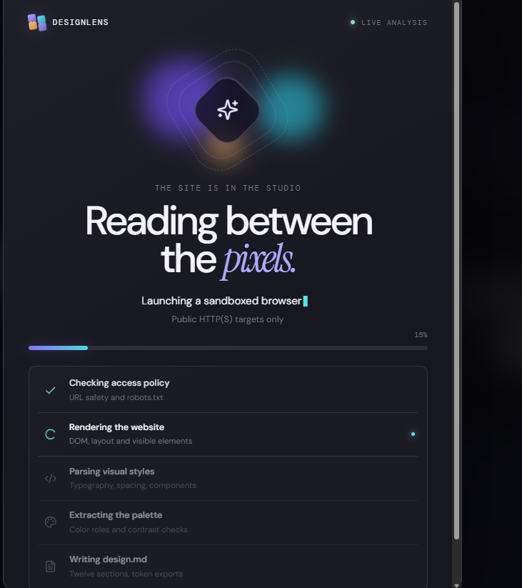
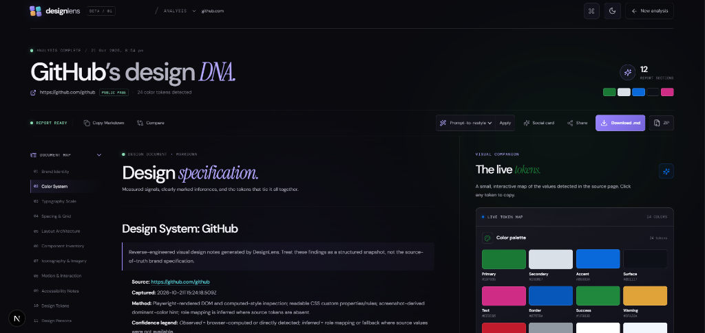
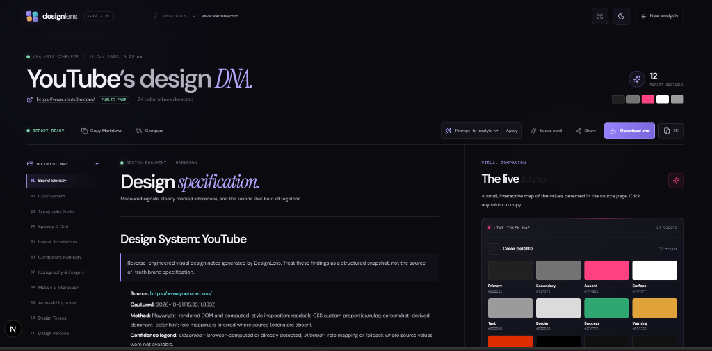
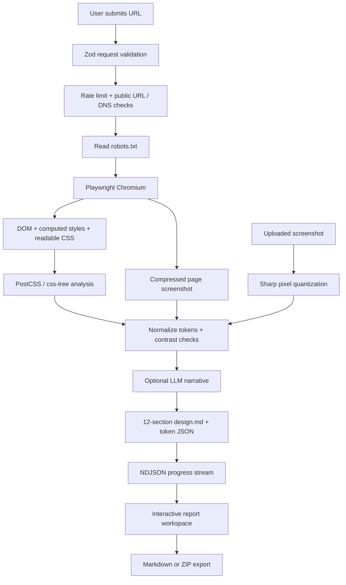

# DesignLens

**Turn a public website into an evidence-backed design system.** DesignLens renders a page in a headless browser, measures its visible UI and CSS, then produces a clean `design.md`, JSON design tokens, and an optional screenshot bundle.

**Live app:** [designlens-p9yd.onrender.com](https://designlens-p9yd.onrender.com/)

<p align="center">
  
</p>

<p align="center">
  <em><strong>Design System Specification &amp; Live Visual Companion:</strong> Interactive 12-section design blueprint, observed color tokens, copyable swatches, and prompt-to-restyle engine.</em>
</p>

---

## Previews

### Studio Pipeline &amp; Multi-Brand Analysis

<table align="center" width="100%">
  <thead>
    <tr>
      <th width="34%" align="center">Real-Time Analysis Pipeline</th>
      <th width="33%" align="center">GitHub's Design DNA</th>
      <th width="33%" align="center">YouTube's Design DNA</th>
    </tr>
  </thead>
  <tbody>
    <tr>
      <td align="center" valign="top">
        <a href="docs/previews/analysis-progress.png">
          
        </a>
        <br /><br />
        <sub><strong>Live Analysis Studio:</strong> Sandboxed Chromium renders target pages, verifies policies, parses computed styles, and streams live progress.</sub>
      </td>
      <td align="center" valign="top">
        <a href="docs/previews/analysis-report-github.png">
          
        </a>
        <br /><br />
        <sub><strong>GitHub Design DNA:</strong> 24 color tokens detected, typography scale, layout architecture, and live companion palette.</sub>
      </td>
      <td align="center" valign="top">
        <a href="docs/previews/analysis-report-youtube.png">
          
        </a>
        <br /><br />
        <sub><strong>YouTube Design DNA:</strong> Reverse-engineered brand identity, dark surface tokens, signature red accents, and export bundle.</sub>
      </td>
    </tr>
  </tbody>
</table>

---

> **Note:** Scraping results are heuristic and are not a substitute for source access, a full browser-based accessibility audit, or a human design review.

## Experience

- Neo-brutalist / glass-inspired landing page with animated hero, cursor spotlight, subtle ambient gradients, and dark/light theme parity.
- Headless browser pipeline for public pages, with DOM/computed-style sampling, CSS variable and rule parsing, screenshot sampling, and explanatory confidence notes.
- Twelve-section Markdown report, live token visualizer, copyable color swatches, scroll-aware document navigation, and downloadable `.md` or `.zip` (`design.md`, `tokens.json`, optional screenshot).
- Persistent user workspace: signed-in users can save design systems to their account, search/filter saved reports, pin favorites, and access their library across devices.
- Production-grade authentication with Supabase Auth: email/password with strength meter, Google & GitHub OAuth, email verification, password recovery, and Row Level Security data isolation.
- Guest analysis preservation: visitors can analyze any public website without an account.
- Screenshot-only fallback: if a page blocks access, provide a PNG, JPEG, or WebP screenshot (up to 3 MB). This mode makes no network requests and explicitly labels typography/layout/behavior that cannot be verified from pixels.
- `⌘K` / `Ctrl+K` command palette, compare mode, visual restyling lens, share-as-image card, reduced-motion support, and keyboard-accessible controls.
- Ephemeral in-memory analysis/cache state for guests; persistent PostgreSQL storage with RLS for authenticated workspaces.
- Privacy and terms routes, a custom 404, canonical metadata, a generated Open Graph social image, SVG favicon, sitemap.xml, and a generated robots.txt.
- HTTPS and canonical-host redirects, HSTS/security headers, and explicit 301 redirects for legacy paths.
- Cookie/analytics consent: optional Google Analytics only loads after opt-in. Report UUID paths are excluded from analytics page views.
- GitHub-ready contribution/security guidance, CI workflow, source secret-pattern check, internal-link checker, and Lighthouse runner.

## Stack

- Next.js 15 App Router + React 19 + TypeScript
- Tailwind CSS 4 + custom CSS design system
- Framer Motion + Lucide icons
- Playwright + `@sparticuz/chromium` for local/serverless Chromium
- PostCSS + `css-tree` for readable CSS analysis; Sharp for screenshot handling and pixel sampling
- Optional OpenAI-compatible chat completions API for narrative synthesis

## Quick start

Requirements: Node.js 20.9+ (Node 22 recommended), npm, and a Chromium-capable runtime.

```bash
git clone <your-fork-url> designlens
cd designlens
cp .env.example .env.local
npm install
npx playwright install chromium
npm run dev
```

Open [http://localhost:3000](http://localhost:3000).

If Playwright cannot discover Chromium locally, point `PLAYWRIGHT_EXECUTABLE_PATH` at an installed Chromium/Chrome executable. On Vercel, Lambda, and Render, the app uses the packaged `@sparticuz/chromium` binary automatically.

### Environment variables

| Variable | Required | Description |
|---|---:|---|
| `NEXT_PUBLIC_SUPABASE_URL` | Required for accounts | Supabase project URL for authentication and workspace database. Guest analysis works without it. |
| `NEXT_PUBLIC_SUPABASE_ANON_KEY` | Required for accounts | Supabase public anon key for client authentication. Guest analysis works without it. |
| `SITE_URL` | Recommended | Final public HTTPS origin, used for canonical metadata, sitemap, robots, and redirects. Defaults to `https://designlens-p9yd.onrender.com`. |
| `OPENAI_API_KEY` | No | Enables optional AI narrative synthesis. Without it, DesignLens uses deterministic templates. |
| `OPENAI_MODEL` | No | Model name accepted by the configured OpenAI-compatible endpoint. |
| `LLM_BASE_URL` | No | Base URL for a compatible API, defaulting to OpenAI's chat-completions endpoint. |
| `ANALYZE_RATE_LIMIT` | No | In-memory analysis limit per client key, defaults to 5 requests per 10-minute window. |
| `ANALYZE_RATE_WINDOW_MS` | No | In-memory rate-limit window in milliseconds. |
| `PLAYWRIGHT_EXECUTABLE_PATH` | No | Optional local Chromium/Chrome executable path. |
| `NEXT_PUBLIC_GA_MEASUREMENT_ID` | No | Google Analytics 4 measurement ID (`G-…`). It is a public identifier, not a secret. Analytics is not loaded until the visitor opts in. |

For detailed instructions on configuring Supabase, SQL migrations, Google/GitHub OAuth, and RLS policies, see [docs/supabase-auth-workspace.md](docs/supabase-auth-workspace.md).

Do not commit `.env.local` or API keys. `OPENAI_API_KEY` and provider credentials are server-only; never expose them through a `NEXT_PUBLIC_` variable. The LLM prompt treats fetched page copy as untrusted input and asks the model not to follow instructions embedded in the website content.

### Privacy, cookies, and legal pages

- `/privacy` and `/terms` are included as starter templates. They are not legal advice. Before production, publish the operator's legal identity and monitored contact channel, then review the language for the actual jurisdiction and providers you enable.
- Consent preferences are stored in local storage. Optional Google Analytics is injected only after opt-in. If the measurement ID is empty, no analytics provider is loaded and the consent UI explains that analytics is not configured.
- The landing footer and legal footers provide **Cookie settings** so visitors can revise their preference later.
- The implementation does not use ad pixels or intentionally send generated report paths to Google Analytics.

### SEO, redirects, and social preview

- Global and per-page metadata set title/description and canonical URLs. `app/opengraph-image.tsx` dynamically generates the social share preview and `app/icon.svg` is the favicon.
- Next.js metadata routes generate `/robots.txt` and `/sitemap.xml`. Private result routes (`/analyze/…`) are marked `noindex` and disallowed in robots.txt.
- `middleware.ts` issues a permanent 301 to the configured canonical HTTPS origin when the production reverse proxy reports an HTTP request, and canonicalizes the `www` hostname when the configured canonical is an apex host. The proxy must overwrite `x-forwarded-proto`; do not blindly trust client-supplied forwarding headers in custom hosting.
- `next.config.ts` adds 301 redirects for `/home` and `/index.html`, HSTS, and common security headers. Use `SITE_URL` for your own final domain.

### Performance and broken-link checks

```bash
npm run check:links
npm run verify:secrets
npm run typecheck
npm run lint
npm run build
npm run dev
# In a second terminal, once the server is ready:
npm run lighthouse
# Or point Lighthouse at a deployed site:
LIGHTHOUSE_URL=https://your-domain.example npm run lighthouse
```

The Lighthouse runner writes HTML and JSON reports to `artifacts/`. Use those reports to check Performance, Accessibility, Best Practices, and SEO on representative desktop/mobile runs. A score has not been claimed here: it must be measured against the deployed app. The page has no inline raster content images; visual product illustrations are CSS/SVG. Browser screenshots are resized and JPEG-compressed with Sharp before they are embedded in analysis results or ZIP exports.

## Architecture



### Request lifecycle

1. `/api/analyze` validates inputs and applies a per-process rate limit.
2. URL mode permits only HTTP(S), blocks credentials and non-standard ports, rejects private/reserved IPs and local/internal hostnames, checks DNS answers, reads `robots.txt`, and re-validates destinations requested by the headless browser. Redirects are checked by the browser request guard.
3. The browser samples visible elements and readable CSS only; cross-origin stylesheets that the browser does not expose are skipped rather than bypassed.
4. Token extraction distinguishes observed values from inferred semantic roles and common fallbacks. The report labels screenshot-only mode and uncertain findings.
5. Results stream as newline-delimited JSON events; a final result is cached in process memory and can be downloaded. In-memory state can disappear on serverless cold starts or across instances. The UI also uses `sessionStorage` temporarily to carry the active report from the landing page to the workspace; it is not a report archive and normally clears when the browser tab session ends.

## What `design.md` contains

1. Brand identity
2. Color system and contrast notes
3. Typography scale and heading specimens
4. Spacing and grid
5. Layout architecture
6. Component inventory and sampled states
7. Iconography, imagery, radii, shadows
8. Motion and interactions
9. Accessibility observations
10. CSS and JSON design tokens
11. Design persona
12. Method, source, timestamp, and attribution

The output intentionally distinguishes observation from inference. For example, a color contrast ratio against pure white/black is not a complete audit of every text/background pairing, and a static initial-state snapshot cannot guarantee that all responsive breakpoints or animation triggers were observed.

## Security and operational limits

- **SSRF defenses are best-effort application checks, not a network sandbox.** Keep the service behind outbound egress controls that deny private, link-local, metadata, and reserved ranges. DNS rebinding can require infrastructure-level protections even when DNS is checked before requests.
- Respect `robots.txt`; inaccessible rules produce a warning and access restrictions are not bypassed. No CAPTCHA bypass, login circumvention, stealth plugins, or credential submission is implemented.
- In-memory rate limiting and cache are per process and reset on restart/cold start. For a public multi-instance service, replace them with a shared Redis/KV store and a trusted proxy-derived client identity.
- Headless Chromium and screenshot processing consume memory/CPU. Put hard concurrency limits around browser launches in shared deployments, and consider a dedicated browser worker for sustained traffic.
- Vercel deployment is configured for a 60-second analyze function. Chromium binaries can make serverless bundles large; check your provider's current function/package limits. If required, use `@sparticuz/chromium-min` with a trusted, pinned remote binary or move browser work to a dedicated worker.
- The requested 60-second completion and Lighthouse targets depend on the target site, network, serverless region, fonts, and deployment configuration. They must be measured against representative live sites rather than inferred from source alone.

## Verify before deployment

```bash
npm run typecheck
npm run lint
npm run build
```

Use `npm run dev` then test at least: a normal static page, a JS-heavy public SPA, a robots-disallowed path, a private-IP URL (must be rejected), an inaccessible site using screenshot-only fallback, keyboard-only navigation, reduced-motion mode, dark/light switching, Markdown export, ZIP export, and a narrow mobile viewport.

## Render deployment

1. Create a Render **Web Service** from the GitHub repository and use the folder containing `package.json` as the Root Directory.
2. Set the Build Command to `npm ci && npm run build` and the Start Command to `npm run start`. Use Node.js 22 or newer. Render is detected at runtime and uses the packaged `@sparticuz/chromium` binary; do not rely on a Playwright browser cache created during the build.
3. Set `SITE_URL=https://designlens-p9yd.onrender.com` (or your final custom domain) in the service environment. `OPENAI_API_KEY` is optional. Add `NEXT_PUBLIC_GA_MEASUREMENT_ID` only if enabling optional Google Analytics.
4. Render serves the app over HTTPS; confirm the canonical host is the configured `SITE_URL`. HSTS is enabled in production.
5. Verify the privacy/terms operator information is current, inspect `/robots.txt`, `/sitemap.xml`, `/opengraph-image`, and `/icon.svg`, then run Lighthouse against the deployment.
6. Smoke-test `POST /api/analyze` with a public URL and confirm it returns newline-delimited JSON with `Content-Type: application/x-ndjson`. Review Render build and runtime logs if it returns a server error.
7. Validate Chromium launch and memory usage in deployment logs. Browser extraction may need a larger service or a dedicated worker/container with outbound network rules; application SSRF checks are not the entire network security boundary.

If the browser bundle exceeds provider limits, deploy the web shell/API to Vercel and run Playwright extraction in a protected worker/container with strict outbound firewall rules.

## Production readiness checklist

See [`docs/production-readiness.md`](./docs/production-readiness.md) for the implementation inventory and launch-time checks. In particular, legal operator details must be supplied by the site owner and Lighthouse must be run against a real deployment; neither can be truthfully completed from this source bundle alone.

## Screenshot documentation

`docs/previews/landing-preview.svg` and `docs/previews/report-preview.svg` are **conceptual, hand-authored layout previews** for documentation, not screenshots captured from a running browser. After dependencies install, capture real responsive screenshots with your preferred Playwright test setup and replace these previews before marketing the deployment as verified.

## Project structure

```text
designlens/
├── app/
│   ├── (marketing)/page.tsx
│   ├── analyze/[id]/page.tsx + layout.tsx
│   ├── api/analyze/route.ts
│   ├── api/export/route.ts
│   ├── privacy/page.tsx
│   ├── terms/page.tsx
│   ├── not-found.tsx
│   ├── robots.ts + sitemap.ts + opengraph-image.tsx + icon.svg
│   ├── globals.css
│   └── layout.tsx
├── components/
│   ├── ui/                         # small reusable button and badge primitives
│   ├── hero-url-input.tsx
│   ├── analysis-loader.tsx
│   ├── design-md-viewer.tsx
│   ├── token-visualizer.tsx
│   ├── cursor-spotlight.tsx
│   ├── command-palette.tsx
│   ├── theme-toggle.tsx
│   ├── cookie-consent.tsx
│   ├── cookie-settings-trigger.tsx
│   └── legal-layout.tsx
├── lib/
│   ├── scraper.ts                  # Playwright + browser evidence
│   ├── css-analysis.ts             # PostCSS / css-tree
│   ├── extract-tokens.ts           # color, type, layout, component heuristics
│   ├── screenshot-only.ts         # offline image sampling fallback
│   ├── security.ts                 # URL, IP/DNS, robots checks
│   ├── jobs.ts                     # process-local rate-limit/cache state
│   ├── synthesize-md.ts            # report assembly + optional LLM
│   └── types.ts
├── prompts/design-md-synthesis.ts
├── styles/tokens.css
├── docs/previews/
├── scripts/check-links.mjs + check-secrets.mjs + run-lighthouse.mjs
├── .github/workflows/ci.yml
├── CONTRIBUTING.md + SECURITY.md + LICENSE
├── package.json
├── middleware.ts + vercel.json
└── README.md
```

## License

This repository is distributed under the MIT License; see [`LICENSE`](./LICENSE). The legal pages are product copy templates and should be reviewed for the operator's circumstances before launch.
